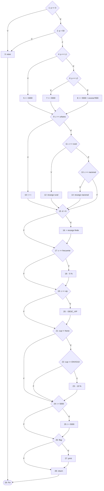

# Parte 4 · Caja blanca

Análisis sobre el código heredado `envios.py` v1.0.0 (función `calc`, líneas 11 a 40).

## 4.1 Grafo de flujo

Cada nodo es una sentencia o condición simple. La condición compuesta de la línea 12 (`p <= 0 or p > 50`) se separa en dos nodos predicado (1 y 2) porque el `or` evalúa en cortocircuito.

| Nodo | Línea | Contenido | Tipo |
|------|-------|-----------|------|
| 1 | 12 | `p <= 0` | predicado |
| 2 | 12 | `p > 50` | predicado |
| 3 | 13 | `raise ValueError("peso invalido")` | sentencia |
| 4 | 14 | `p <= CONFIG["L1"]` | predicado |
| 5 | 15 | `t = 6000` | sentencia |
| 6 | 16 | `p <= CONFIG["L2"]` | predicado |
| 7 | 17 | `t = 9000` | sentencia |
| 8 | 19 | `t = 9000 + (p - L2) * 800` | sentencia |
| 9 | 20 | `z == "urbana"` | predicado |
| 10 | 21 | `t = t` | sentencia |
| 11 | 22 | `z == "rural"` | predicado |
| 12 | 23 | `t = t + t * RECARGO_RURAL` | sentencia |
| 13 | 24 | `z == "nacional"` | predicado |
| 14 | 25 | `t = t + t * RECARGO_NACIONAL` | sentencia |
| 15 | 27 | `d > 6` | predicado |
| 16 | 28 | `t = t + RECARGO_FINDE` | sentencia |
| 17 | 29 | `c == "frecuente"` | predicado |
| 18 | 30 | `t = t - t * 0.05` | sentencia |
| 19 | 31 | `c == "vip"` | predicado |
| 20 | 32 | `t = t - t * DESC_VIP` | sentencia |
| 21 | 33 | `cup != None` | predicado |
| 22 | 34 | `cup == "ENVIO10"` | predicado |
| 23 | 35 | `t = t - t * 0.10` | sentencia |
| 24 | 36 | `t < 5000` | predicado |
| 25 | 37 | `t = 5000` | sentencia |
| 26 | 38 | `flag` | predicado |
| 27 | 39 | `print("costo:", t)` | sentencia |
| 28 | 40 | `return int(t / 100) * 100` | sentencia |
| 29 | — | Fin | salida |

Lista de aristas (42):

1→2, 1→3, 2→3, 2→4, 3→29, 4→5, 4→6, 5→9, 6→7, 6→8, 7→9, 8→9, 9→10, 9→11, 10→15, 11→12, 11→13, 12→15, 13→14, 13→15, 14→15, 15→16, 15→17, 16→17, 17→18, 17→19, 18→19, 19→20, 19→21, 20→21, 21→22, 21→24, 22→23, 22→24, 23→24, 24→25, 24→26, 25→26, 26→27, 26→28, 27→28, 28→29.

## 4.2 Complejidad ciclomática de tres formas

**a) Aristas y nodos:** V(G) = E − N + 2 = 42 − 29 + 2 = **15**

**b) Nodos predicado:** V(G) = P + 1. Los predicados son los nodos 1, 2, 4, 6, 9, 11, 13, 15, 17, 19, 21, 22, 24 y 26 → P = 14 → V(G) = 14 + 1 = **15**

**c) Regiones:** el grafo dibujado en el plano tiene 14 regiones cerradas (una por cada nodo predicado, que abre una bifurcación que luego se cierra) más la región exterior → **15** regiones.

Las tres formas coinciden: **V(G) = 15**. La herramienta `radon cc` reporta lo mismo: `calc - C (15)`, rango C (complejidad moderada-alta, riesgo medio). Se necesitan como máximo 15 caminos independientes.

## 4.3 Caminos independientes y casos de prueba

Camino base (CB-03): peso de tramo 1, urbana, normal, entre semana, sin cupón, sin flag. Cada camino siguiente cambia una decisión y agrega al menos una arista nueva.

| # | Camino (nodos) | Arista nueva | Caso | Entradas (p, z, c, d, cup, flag) | Esperado según especificación |
|---|----------------|--------------|------|----------------------------------|-------------------------------|
| 1 | 1-3-29 | 1→3 | CB-01 | 0, urbana, normal, 1 | Error “peso inválido” |
| 2 | 1-2-3-29 | 2→3 | CB-02 | 51, urbana, normal, 1 | Error “peso inválido” |
| 3 | 1-2-4-5-9-10-15-17-19-21-24-26-28-29 | camino base | CB-03 | 1, urbana, normal, 1 | $6.000 |
| 4 | 1-2-4-6-7-9-10-15-17-19-21-24-26-28-29 | 4→6, 6→7 | CB-04 | 5, urbana, normal, 1 | $9.000 |
| 5 | 1-2-4-6-8-9-10-15-17-19-21-24-26-28-29 | 6→8 | CB-05 | 20, urbana, normal, 1 | $17.000 |
| 6 | 1-2-4-5-9-11-12-15-17-19-21-24-26-28-29 | 9→11, 11→12 | CB-06 | 1, rural, normal, 1 | 6.000 × 1,20 = $7.200 |
| 7 | 1-2-4-5-9-11-13-14-15-17-19-21-24-26-28-29 | 11→13, 13→14 | CB-07 | 1, nacional, normal, 1 | 6.000 × 1,50 = $9.000 |
| 8 | 1-2-4-5-9-11-13-15-17-19-21-24-26-28-29 | 13→15 | CB-08 | 1, internacional, normal, 1 | Error (zona inválida) |
| 9 | 1-2-4-5-9-10-15-16-17-19-21-24-26-28-29 | 15→16 | CB-09 | 1, urbana, normal, 7 | 6.000 + 2.000 = $8.000 |
| 10 | 1-2-4-5-9-10-15-17-18-19-21-24-26-28-29 | 17→18 | CB-10 | 1, urbana, frecuente, 1 | 6.000 × 0,95 = $5.700 |
| 11 | 1-2-4-5-9-10-15-17-19-20-21-24-26-28-29 | 19→20 | CB-11 | 1, urbana, vip, 1 | 6.000 × 0,85 = $5.100 |
| 12 | 1-2-4-5-9-10-15-17-19-21-22-24-26-28-29 | 21→22, 22→24 | CB-12 | 1, urbana, normal, 1, NOEXISTE | Error (cupón inexistente) |
| 13 | 1-2-4-5-9-10-15-17-19-21-22-23-24-26-28-29 | 22→23 | CB-13 | 1, urbana, normal, 1, ENVIO10 | 6.000 × 0,90 = $5.400 |
| 14 | 1-2-4-5-9-10-15-17-19-20-21-22-23-24-25-26-28-29 | 24→25 | CB-14 | 1, urbana, vip, 1, ENVIO10 | 4.590 → mínimo $5.000 |
| 15 | 1-2-4-5-9-10-15-17-19-21-24-26-27-28-29 | 26→27 | CB-15 | 1, urbana, normal, 1, —, flag=True | $6.000 (e imprime el costo) |

Observación: los caminos 8 y 12 existen en el código pero la especificación exige un error en esos casos (R2 y R7). El código heredado devuelve $6.000 en ambos, así que CB-08 y CB-12 fallan: son los defectos DEF-02 y DEF-05 vistos desde la estructura (falta una rama `else` que lance el error).

## 4.4 Cobertura de sentencias y de ramas

**Cobertura de sentencias (100 %).** Cada sentencia se ejecuta al menos una vez con estos casos:

| Sentencia (nodo) | Caso que la ejecuta |
|------------------|---------------------|
| 3 `raise` | CB-01 |
| 5 `t = 6000`, 10 `t = t` | CB-10 |
| 7 `t = 9000` | CB-04 |
| 8 tramo 3 | CB-05 |
| 12 recargo rural | CB-06 |
| 14 recargo nacional | CB-07 |
| 16 recargo fin de semana | CB-09 |
| 18 descuento frecuente | CB-10 |
| 20 descuento VIP, 23 cupón, 25 mínimo | CB-14 |
| 27 `print` | CB-15 |
| 28 `return` | todos menos CB-01 y CB-02 |

Conjunto para sentencias: **CB-01, CB-04, CB-05, CB-06, CB-07, CB-09, CB-10, CB-14 y CB-15** (9 casos).

**Cobertura de ramas (100 %).** Además de lo anterior hay que recorrer las salidas “falso” que no tienen sentencia propia:

| Rama que falta | Caso que la recorre |
|----------------|---------------------|
| 2→3 (`p > 50` verdadero) | CB-02 |
| 13→15 (zona que no es ninguna de las tres) | CB-08 |
| 22→24 (cupón distinto de ENVIO10) | CB-12 |
| 21→24, 24→26, 15→17, 17→19, 19→21 (salidas “falso”) | CB-03 |
| 22→23 con cliente normal | CB-13 |
| 19→20 sin cupón | CB-11 |

Conjunto para ramas: **los 15 casos CB-01 a CB-15** recorren las 42 aristas, es decir, las dos salidas de los 14 predicados. Los casos que solo aportan a ramas (y no a sentencias) son CB-02, CB-03, CB-08 y CB-12; CB-11 y CB-13 son redundantes para cobertura pero se mantienen porque completan el conjunto base de caminos.

Nota: `pytest-cov` mide ramas por línea, así que no distingue 1→3 de 2→3 (ambas están en la línea 12). Por eso CB-02 es necesario para la cobertura de condiciones aunque la herramienta ya marque la línea como cubierta con CB-01.
