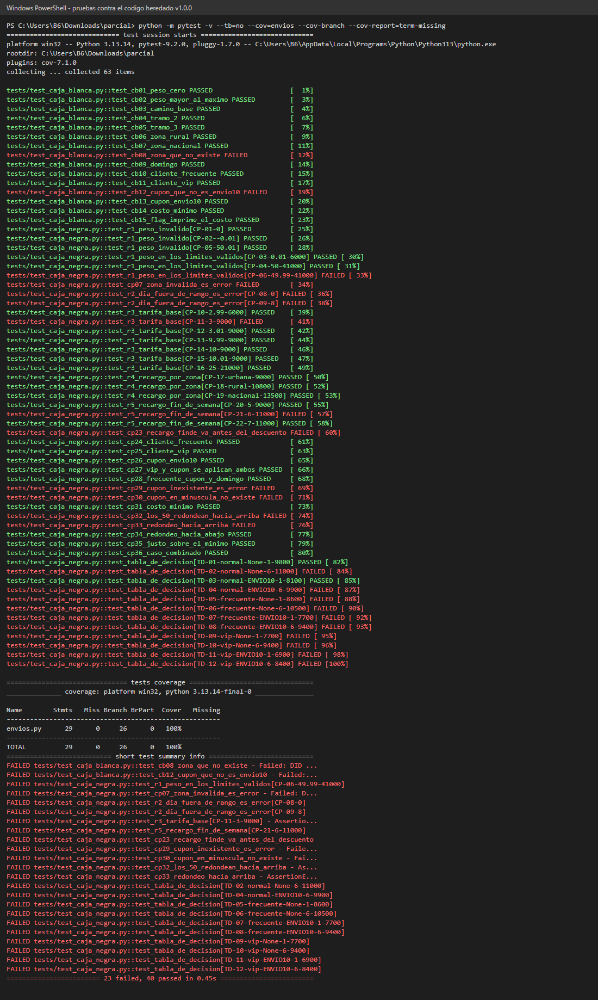

# Parte 5 · Automatización, ejecución y defectos

## 5.1 Automatización

La suite está en [tests/](../tests) y se ejecuta con pytest:

| Archivo | Contenido | Pruebas |
|---------|-----------|---------|
| `tests/test_caja_negra.py` | CP-01 a CP-36 y tabla de decisión TD-01 a TD-12 (48 casos) | 48 |
| `tests/test_caja_blanca.py` | CB-01 a CB-15, un caso por camino independiente | 15 |
| **Total** | | **63** |

Comando: `python -m pytest -v --tb=no --cov=envios --cov-branch --cov-report=term-missing`

## 5.2 Ejecución contra el código heredado v1.0.0

Resultado real: **63 pruebas, 40 pasan y 23 fallan** (`evidencia/01-pruebas-v1.0.0.txt`).

Cobertura medida con pytest-cov sobre `envios.py` (v1.0.0):

| Sentencias | Ramas | Cobertura sentencias | Cobertura ramas |
|-----------:|------:|---------------------:|----------------:|
| 29 (0 sin cubrir) | 26 (0 parciales) | **100 %** | **100 %** |

Que la cobertura sea del 100 % no significa que el código sea correcto: la cobertura dice qué líneas se ejecutaron, no si el resultado es el que pide la especificación. Aquí las líneas con defectos están todas cubiertas y aun así devuelven valores errados.

## 5.3 Registro de defectos

Se analizó cada una de las 23 pruebas que fallan. Todas se explican por los 6 defectos de abajo. Las reglas de mi especificación que el código heredado **sí** cumple (y que por eso no se reportan) son: peso máximo 50 (coincide con PMAX = 50), tramo 2 hasta L2 inclusive, recargos rural 20 % y nacional 50 %, recargo de fin de semana antes de los descuentos (E par), aplicación de ambos descuentos en orden cliente → cupón (B impar) y mínimo de $5.000.

Escala de severidad: **Crítica** (pérdida masiva o caída), **Alta** (cobra un valor incorrecto en casos comunes), **Media** (cobra un valor incorrecto con entradas inválidas o poco frecuentes), **Baja** (cosmético). Prioridad: **P1** corregir ya, **P2** en este ciclo, **P3** después.

### DEF-01 · El peso exacto de 3 kg se cobra como tramo 1

| Campo | Detalle |
|-------|---------|
| Requisito | R3 (regla D impar: tramo 1 es peso < L1) |
| Línea | 14: `if p <= CONFIG["L1"]` |
| Pasos | `calc(3, "urbana", "normal", 1)` |
| Esperado | $9.000 (3 no es menor que 3, va al tramo 2) |
| Obtenido | $6.000 |
| Pruebas que fallan | CP-11 |
| Severidad | **Alta**: cobra $3.000 menos en un valor de peso muy común (3 kg). |
| Prioridad | **P1**: afecta ingresos y es un cambio de una línea. |

### DEF-02 · Una zona inválida no genera error

| Campo | Detalle |
|-------|---------|
| Requisito | R2 |
| Línea | 20 a 25: la cadena `if/elif` de zonas no tiene `else` |
| Pasos | `calc(5, "insular", "normal", 1)` |
| Esperado | Error por zona inválida |
| Obtenido | $9.000 (se trata como urbana sin avisar) |
| Pruebas que fallan | CP-07, CB-08 |
| Severidad | **Media**: un error de digitación se cobra como urbana en silencio; solo ocurre con datos inválidos. |
| Prioridad | **P2**: debería validarse, pero normalmente la interfaz restringe las zonas. |

### DEF-03 · Un día fuera del rango 1 a 7 no genera error

| Campo | Detalle |
|-------|---------|
| Requisito | R2 |
| Línea | 27: solo se pregunta `d > 6`, nunca se valida el rango |
| Pasos | `calc(5, "urbana", "normal", 0)` y `calc(5, "urbana", "normal", 8)` |
| Esperado | Error por día inválido en ambos |
| Obtenido | $9.000 con día 0 y $11.000 con día 8 (cobra fin de semana) |
| Pruebas que fallan | CP-08, CP-09 |
| Severidad | **Media**: solo con datos inválidos, pero el día 8 llega a cobrar un recargo que no corresponde. |
| Prioridad | **P2** |

### DEF-04 · El sábado no cobra el recargo de fin de semana

| Campo | Detalle |
|-------|---------|
| Requisito | R5 (sábado = 6 y domingo = 7) |
| Línea | 27: `if d > 6` |
| Pasos | `calc(5, "urbana", "normal", 6)` |
| Esperado | $11.000 (9.000 + 2.000) |
| Obtenido | $9.000 |
| Pruebas que fallan | CP-21, CP-23 y TD-02, TD-04, TD-06, TD-08, TD-10, TD-12 |
| Severidad | **Alta**: se deja de cobrar $2.000 todos los sábados, es decir, a la mitad de los días de recargo. |
| Prioridad | **P1**: pérdida de ingresos recurrente. |

### DEF-05 · Un cupón inexistente se ignora

| Campo | Detalle |
|-------|---------|
| Requisito | R7 (regla F impar: es error) |
| Línea | 33 a 35: `if cup == "ENVIO10"` sin `else` |
| Pasos | `calc(5, "urbana", "normal", 1, "DESCUENTO99")` |
| Esperado | Error por cupón inexistente |
| Obtenido | $9.000 (sin avisar que el cupón no sirvió) |
| Pruebas que fallan | CP-29, CP-30, CB-12 |
| Severidad | **Media**: el cliente cree que tiene un descuento que no recibió, pero el sistema cobra el valor completo. |
| Prioridad | **P2** |

### DEF-06 · El redondeo trunca en vez de redondear al $100 más cercano

| Campo | Detalle |
|-------|---------|
| Requisito | R8 |
| Línea | 40: `return int(t / 100) * 100` |
| Pasos | `calc(5, "urbana", "frecuente", 1)` (el valor calculado es 8.550) |
| Esperado | $8.600 (los $50 suben) |
| Obtenido | $8.500 |
| Pruebas que fallan | CP-06 (40.992 da 40.900 en lugar de 41.000), CP-32, CP-33 y TD-05 a TD-12 |
| Severidad | **Alta**: afecta a todo valor con descuento y siempre en contra del negocio (hasta $99 menos por envío). |
| Prioridad | **P1**: error sistemático en cada cotización con decimales. |

Nota técnica: además del truncamiento, el cálculo en `float` puede dejar valores como 6884,999… en lugar de 6885, que redondearían mal aun con `round`. Por eso la corrección usa aritmética decimal exacta.

## 5.4 Matriz de trazabilidad con defectos

| Requisito | Historia | Casos | Resultado v1.0.0 | Defecto |
|-----------|----------|-------|------------------|---------|
| R1 | HU-1 | CP-01 a CP-05, CB-01, CB-02 | Pasan (CP-06 falla por DEF-06) | — |
| R2 | HU-1 | CP-07, CP-08, CP-09, CB-08 | **Fallan** | DEF-02, DEF-03 |
| R3 | HU-2 | CP-10 a CP-16 | CP-11 **falla** | DEF-01 |
| R4 | HU-2 | CP-17 a CP-19, CB-06, CB-07 | Pasan | — |
| R5 | HU-2 | CP-20 a CP-23, TD-02, 04, 06, 08, 10, 12 | CP-21, CP-23 y los TD con día 6 **fallan** | DEF-04 |
| R6 | HU-3 | CP-24 a CP-28, CP-35, CP-36, CB-10, 11, 13 | Pasan | — |
| R7 | HU-1 | CP-29, CP-30, CB-12 | **Fallan** | DEF-05 |
| R8 | HU-3 | CP-31 a CP-36, TD-05 a TD-12 | CP-32, CP-33 y TD con valores en 50 **fallan** | DEF-06 |

## 5.5 Métricas sobre v1.0.0

| Métrica | Valor |
|---------|-------|
| Casos ejecutados | 63 |
| Casos que pasan | 40 → **63,5 %** (40 / 63) |
| Casos que fallan | 23 → 36,5 % |
| Defectos por severidad | Crítica 0 · **Alta 3** (DEF-01, DEF-04, DEF-06) · **Media 3** (DEF-02, DEF-03, DEF-05) · Baja 0 |
| Defectos por prioridad | P1 3 · P2 3 |
| Líneas del código | 40 (37 de código sin comentarios ni blancos, según radon) |
| Densidad de defectos | 6 defectos / 40 líneas × 100 = **15 defectos por cada 100 líneas** (16,2 sobre las 37 líneas de código) |
| Cobertura de sentencias | **100 %** (29 de 29) |
| Cobertura de ramas | **100 %** (26 de 26) |
| Complejidad ciclomática | 15 |
