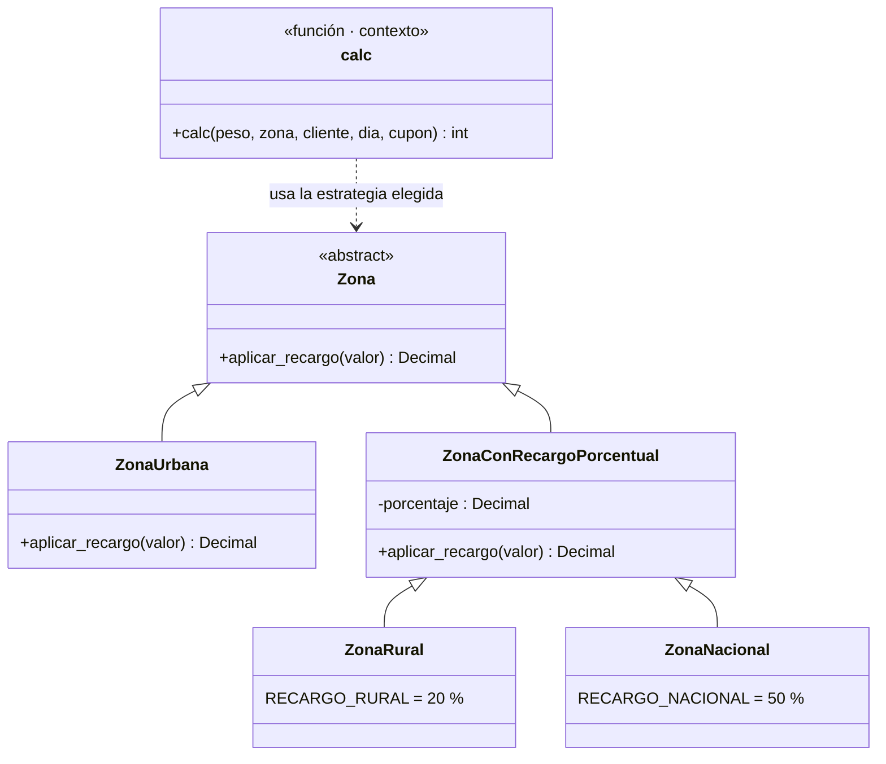

# Parte 6 · Mantenimiento y refactorización

## 6.1 Malos olores del código heredado v1.0.0

Las líneas son las de `envios.py` en v1.0.0 (`git show v1.0.0:envios.py`).

| # | Mal olor (nombre técnico) | Línea(s) | Deuda técnica que genera |
|---|---------------------------|----------|--------------------------|
| 1 | **Números mágicos** (*Magic Numbers*): 50, 6000, 9000, 800, 0.05, 0.10, 5000, 100 | 12, 15, 17, 19, 30, 35, 37, 40 | Quien lee no sabe qué significa cada número. Un cambio de tarifa obliga a buscar y editar valores sueltos, con riesgo de dejar alguno sin cambiar. Además la mitad de los valores está en `CONFIG` y la otra mitad en el código, sin criterio. |
| 2 | **Argumento bandera** (*Flag Argument*) y mezcla de lógica con entrada/salida | 11, 38, 39 | La función hace dos cosas según un booleano e imprime en consola desde la lógica de negocio. Es difícil de probar y de reutilizar en un servicio web. Cada llamada puede comportarse distinto. |
| 3 | **Nombres misteriosos** (*Mystery Name*): `p`, `z`, `c`, `d`, `cup`, `t` | 11 a 40 | El código no se explica solo; hay que leer toda la función para saber que `t` es el valor acumulado. Cuesta mucho más el mantenimiento por alguien nuevo. |
| 4 | **Método largo / función Dios** (*Long Method*, *God Function*) | 11 a 40 | Una sola función valida, calcula tarifa, recargos, descuentos y redondea. Complejidad ciclomática 15, difícil de probar por partes. Cualquier cambio toca todo. |
| 5 | **Condicional en cadena sobre un tipo** (*Switch Statements* / *Conditional Complexity*) | 20 a 25 | Cada zona nueva obliga a modificar la función con otro `elif` (viola el principio abierto/cerrado). Es justo lo que se resuelve con el patrón Estrategia. |
| 6 | **Código muerto / sentencia redundante** (*Dead Code*): `t = t` | 21 | No hace nada, confunde al lector y sugiere que algo falta. |
| 7 | **Código duplicado** (*Duplicated Code*): `t = t ± t * x` repetido en cinco lugares | 23, 25, 30, 32, 35 | Si cambia la forma de aplicar un porcentaje, hay que corregirla cinco veces. |
| 8 | **Condicionales anidados y comparación no idiomática** (`!= None` con `if` dentro de otro `if`) | 33 a 35 | Es más difícil de leer y de seguir; en Python debe ser `is not None`. Y la rama `else` faltante ocultó el defecto DEF-05. |
| 9 | **Obsesión por los primitivos** (*Primitive Obsession*): zona, cliente y cupón son cadenas sueltas sin validación | 20, 29, 31, 34 | Un error de escritura (“Rural”, “rural ”) pasa en silencio. Origen de DEF-02 y DEF-05. |
| 10 | **Uso de `float` para dinero** | 19 a 40 | Los errores de precisión (6884,999…) pueden alterar el redondeo. Se agrava con el defecto DEF-06. |
| 11 | **Estado global mutable** (`CONFIG` como diccionario modificable) | 2 a 9 | Cualquier módulo puede cambiar las tarifas en ejecución y las pruebas se contaminan entre sí. |

## 6.2 Clasificación de los cambios

| Cambio | Tipo de mantenimiento | Justificación |
|--------|----------------------|---------------|
| DEF-01 a DEF-06 (corregir límite L1, zona, día, sábado, cupón, redondeo) | **Correctivo** | Se corrige un comportamiento que incumple la especificación. |
| Usar `Decimal` en lugar de `float` | **Correctivo** | Parte de la corrección de DEF-06 (precisión del redondeo). |
| Extraer funciones, renombrar variables, eliminar `t = t` y duplicación | **Preventivo** | No cambia el comportamiento; reduce el riesgo de futuros defectos y facilita el cambio. |
| Reemplazar números mágicos por constantes con nombre | **Preventivo** | Igual: reduce la deuda técnica sin cambiar resultados. |
| Aplicar el patrón Estrategia a las zonas | **Preventivo** | Prepara el código para zonas nuevas (como la insular de la Parte 8). |
| Eliminar el argumento `flag` | **Perfectivo** | Mejora la interfaz de la función; es un cambio incompatible, por eso sube la versión mayor. |
| Pruebas nuevas de unidad y de regresión | **Preventivo** | Protegen el código frente a cambios futuros. |
| Zona insular (Parte 8) | **Perfectivo** | Amplía la funcionalidad por una solicitud del negocio. No es adaptativo porque no responde a un cambio del entorno técnico o legal (sistema operativo, ley, plataforma). |

## 6.3 Refactorización realizada (rama `refactor/estrategia`)

1. **Funciones extraídas:** `validar_peso`, `obtener_zona`, `validar_dia`, `obtener_descuento_cupon`, `tarifa_base`, `es_fin_de_semana`, `aplicar_descuento`, `aplicar_costo_minimo`, `redondear`. `calc` queda como una receta de 10 pasos.
2. **Constantes con nombre:** `PESO_MAXIMO`, `LIMITE_TRAMO_1`, `LIMITE_TRAMO_2`, `TARIFA_TRAMO_1`, `TARIFA_TRAMO_2`, `TARIFA_POR_KG_EXTRA`, `RECARGO_RURAL`, `RECARGO_NACIONAL`, `RECARGO_FIN_DE_SEMANA`, `DESCUENTO_FRECUENTE`, `DESCUENTO_VIP`, `DESCUENTO_ENVIO10`, `COSTO_MINIMO`, `MULTIPLO_REDONDEO`, entre otras.
3. **Argumento `flag` eliminado**, junto con el `print`. Quien necesite el valor lo imprime en el código que llama a `calc`.
4. **Patrón Estrategia aplicado a las zonas:** cada zona es una clase que implementa `aplicar_recargo`. `calc` ya no conoce las zonas: pide la estrategia y la usa.
5. **Nombres claros:** `peso`, `zona`, `cliente`, `dia`, `cupon`, `valor`.

### Diagrama de clases UML

El diccionario `ZONAS` relaciona el nombre de la zona con su estrategia. Agregar una zona nueva es crear una clase y registrarla; `calc` no cambia.

## 6.4 Corrección de defectos

Los seis defectos se corrigieron cada uno en su rama (`fix/DEF-01` a `fix/DEF-06`), ver la Parte 7. La versión resultante se etiquetó como `v1.0.1`.

## 6.5 Pruebas de regresión

Se ejecutaron las mismas pruebas (63 originales) tras las correcciones y tras la refactorización, y se sumaron 23 pruebas de unidad de las piezas nuevas.

| Versión | Resultado | Evidencia |
|---------|-----------|-----------|
| v1.0.0 (heredado) | 23 fallan, 40 pasan (de 63) | `evidencia/01-pruebas-v1.0.0.png` |
| v1.0.1 (defectos corregidos) | **63 pasan** | `evidencia/02-pruebas-v1.0.1.png` |
| v2.0.0 (refactorizado) | **85 pasan, 1 omitida** (de 86) | `evidencia/03-pruebas-v2.0.0.png` |

La prueba omitida es CB-15 (verifica que `flag=True` imprima): no aplica porque el argumento `flag` ya no existe. Se omite con una condición explícita y no se borra, para que quede registro de la decisión. Las otras 62 pruebas originales pasan sin modificar ni una sola.

## 6.6 Antes y después

| Medida | v1.0.0 | v2.0.0 |
|--------|-------:|-------:|
| Complejidad ciclomática de `calc` | **15** (rango C) | **2** (rango A) |
| Complejidad máxima de cualquier función | 15 | 3 |
| Complejidad promedio (radon) | 15 | 1,7 |
| Funciones / clases | 1 / 0 | 10 / 5 |
| Líneas totales | 40 | 156 |
| Líneas de código (sin comentarios ni blancos) | 37 | 96 |
| Argumentos de `calc` | 6 (con `flag`) | 5 |
| Cobertura de sentencias | 100 % (29 de 29) | 100 % (87 de 87) |
| Cobertura de ramas | 100 % (26 de 26) | 100 % (12 de 12) |
| Defectos conocidos abiertos | 6 | 0 |

Lectura honesta: **el código creció** (de 40 a 156 líneas) por las constantes con nombre, las clases de zona y los docstrings. Lo que se ganó no es brevedad: la complejidad de cada pieza bajó de 15 a 3 como máximo, cada regla vive en un solo lugar y se puede probar por separado. Por eso el número de líneas no es un buen indicador de calidad, y la cobertura del 100 % ya era alta antes de corregir (no garantizaba que los resultados fueran correctos).
